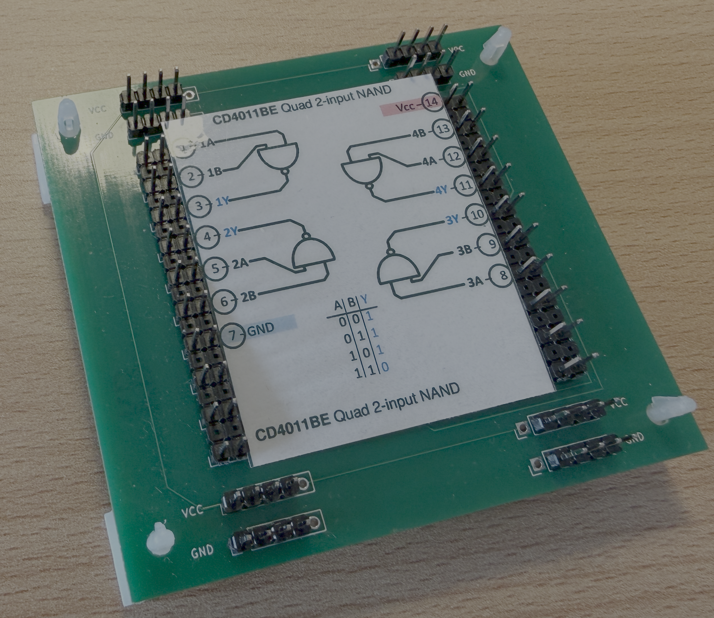

# Elektronische Bauteilsammlung

Dieses Projekt dokumentiert meine elektronischen Bauteile zum Nachschlagen und Experimentieren. Gesammelt werden Typbezeichnungen, Funktionen, Gehäuseangaben, Herstellerdatenblätter und Pinbelegungen. Grundlage sind vorhandene Bauteilübersichten und Fotos; unsichere Beschriftungen und verwendete Referenzvarianten sind dokumentiert.

Der vollständige Bestand steht in **[Bauteile.md](Bauteile.md)**. Die Tabellen sind nach Atmel AVR, SN74xx, CD4xxx, Diverse, Transistoren, MOSFETs, Triacs/Thyristoren, Spannungsreglern, Dioden, Zenerdioden, Quarzen, Optokopplern und Mikroprozessorbasteleien gegliedert. Sie enthalten Links zu den lokalen Datenblättern und den verfügbaren Experimentierkarten. Mit der Textsuche lassen sich beispielsweise BCD-Bausteine, Flipflops, Zähler oder Schieberegister finden. Bei den Quarzen sind jeweils 10 Stück erfasst; für einen Teil der ICs sind ebenfalls Stückzahlen eingetragen. Die übrigen Stückzahlen sind noch offen.

Für die DIL-ICs gibt es **Experimentierkarten im Format 45 × 55 mm**. Sie zeigen Funktion und Pinbelegung und werden zwischen die Anschlussleisten meiner Experimentierboards eingelegt; das IC sitzt auf der Rückseite. Die Karten liegen als PNG, SVG und einzelne PDF-Dateien vor. Zusätzlich gibt es einen A4-Druckbogen. Der Pinabstand beträgt 5,08 mm, beim separaten 24-Pin-Board für den MAX7219 2,54 mm.

- [Bauteilbestand und Funktionen](Bauteile.md)
- [Beispielschaltungen nach Bauteilgruppen](Beispiele/README.md) – separate Sammlungen für bisher 320 Bauteile; möglichst fünf verschiedene Websites pro Bauteil, mit gekennzeichneten Grundschaltungen und [offenen Recherchen](Beispiele/Recherchebedarf.md)
- [SQLite-Datenbank](Bauteile.db) – 327 Einträge in der Tabelle `Bauteile`; erste Spalte `Type` mit den Kategorien `Atmel AVR`, `IC SN7xxx`, `IC CD4xxx`, `IC diverse`, `Transitor`, `MOSFET`, `Spannungsregler`, `Triac_Thyristor`, `Diode`, `Quarz`, `Optokoppler` und `Mikroprozessorbasteleien`.
- [Datenblätter nach Kategorien](Datenblaetter/README.md)
- [Experimentierkarten und Druckhinweise](images/README.md)
- [A4-Druckbogen](images/IC_Karten_A4.pdf) – mit **100 % / tatsächlicher Größe** drucken

Die **[Schaltungsbeispiele](Beispiele/README.md)** stehen separat im Ordner `Beispiele/`, damit die Bestandstabellen übersichtlich bleiben. Die Sammlung umfasst bisher **320 Bauteile** mit **1.876 Linkzuordnungen**. Für **302 Bauteile** sind Beispiele von mindestens fünf verschiedenen Websites zugeordnet; bei **18 Bauteilen** besteht noch [Recherchebedarf](Beispiele/Recherchebedarf.md). Die fünf am 11.11.2026 ergänzten AVR-Typen haben noch keine recherchierten Beispielschaltungen; die vorhandenen ATMEGA328P-PU stehen im Bestand jetzt unter Atmel AVR. Bestand ergänzt: **11.11.2026**; bisherige Linkrecherche: **25.10.2026**. Ein Artikel kann mehreren passenden Bauteilen zugeordnet sein.

Die Beispiele sind nach Bauteilgruppen aufgeteilt:

- [SN74xx](Beispiele/Beispielschaltungen_SN74xx.md) und [CD4xxx](Beispiele/Beispielschaltungen_CD4xxx.md)
- [Diverse ICs und Relais](Beispiele/Beispielschaltungen_Diverse.md)
- [Transistoren](Beispiele/Beispielschaltungen_Transistoren.md) und [MOSFETs](Beispiele/Beispielschaltungen_MOSFETs.md)
- [Triacs und Thyristoren](Beispiele/Beispielschaltungen_Triacs_Thyristoren.md)
- [Spannungsregler](Beispiele/Beispielschaltungen_Spannungsregler.md), [Dioden](Beispiele/Beispielschaltungen_Dioden.md), [Quarze](Beispiele/Beispielschaltungen_Quarze.md) und [Optokoppler](Beispiele/Beispielschaltungen_Optokoppler.md)

- [Mikroprozessorbasteleien](Beispiele/Beispielschaltungen_Mikroprozessorbasteleien.md) – drei neue Einträge, Beispielrecherche noch offen

Konkrete Aufbauten, übertragbare Grundschaltungen, Modulbeispiele und reine Referenzen sind gekennzeichnet. Grundschaltungen können andere Bauteiltypen verwenden; Pinbelegung, Versorgung, Polarität und Dimensionierung müssen zum vorhandenen Typ passen. Reine Funktionsreferenzen zählen nicht zum Ziel von fünf Beispiel-Websites. Die Schaltungen wurden hier nicht aufgebaut.

Die Zuordnungen werden in [Beispiele/Beispielschaltungen.json](Beispiele/Beispielschaltungen.json) gepflegt. Mit `python3 scripts/update_examples.py` werden die separaten Markdown-Sammlungen, die Übersicht und der Recherchebedarf erzeugt. Der Bestand in `Bauteile.md` und `Bauteile.db` bleibt dabei unverändert. Der Ordner `Beispiele/` wird von Git berücksichtigt; `Quellen/` bleibt ausgeschlossen.

Die Originalübersichten, Foto-PDFs und Erkennungsprotokolle liegen unter `Quellen/`. Die verwendeten Pinbelegungsreferenzen sind in [images/karten.json](images/karten.json) erfasst; der [Kartengenerator](scripts/kaertchen/README.md) liegt unter `scripts/kaertchen/`.

Die Datenbank enthält Funktionen, Gehäuse, erfasste und noch offene Stückzahlen, Variantenhinweise, relative Datenblatt- und Kartenpfade sowie Herstellerreferenzen und Quellen-URLs, soweit dokumentiert. Die ungeklärten Lesarten MPS2507A und 2N5501 bleiben in der Fotoauswertung dokumentiert. 

`Bauteile.md` ist die führende Quelle; bei Abweichungen wird `Bauteile.db` anhand der Markdown-Datei aktualisiert.

**Vollständiger Datenbankimport:** `python3 scripts/build_db.py` ersetzt die bestehende Datenbanktabelle aus Markdown und Datenblattquellen. Diesen Import nur auf ausdrückliche Anweisung ausführen.

Referenzdatenblätter und Karten nennen die zugrunde gelegte Variante. Bei unvollständigen Typangaben bleibt die genaue Zuordnung offen. Für LH6764-20 liegt bisher nur eine Identifikationskarte ohne Pinbelegung vor. Die Tabellen enthalten außerdem Hinweise zur Versorgung und zu Besonderheiten der einzelnen Bauteile.
