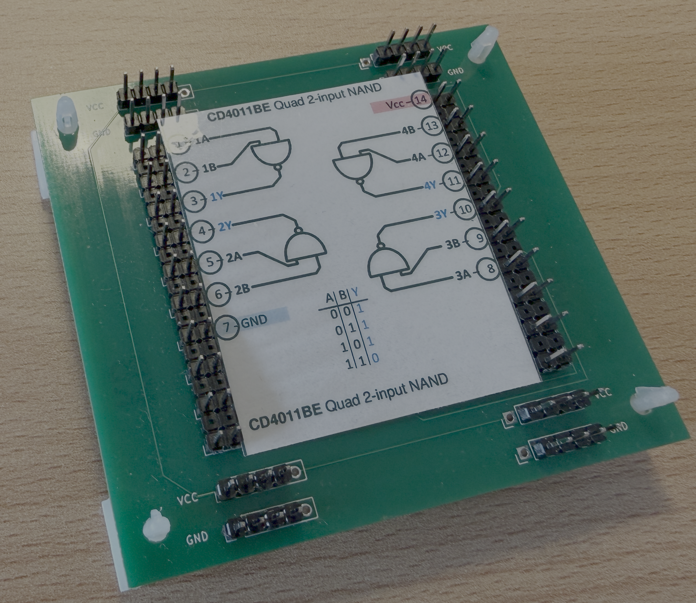

# Elektronische Bauteilsammlung

Dieses Projekt dokumentiert meine elektronischen Bauteile zum Nachschlagen und Experimentieren. Gesammelt werden Typbezeichnungen, Funktionen, Gehäuseangaben, Herstellerdatenblätter und Pinbelegungen. Grundlage sind vorhandene Bauteilübersichten und Fotos; unsichere Beschriftungen und verwendete Referenzvarianten sind dokumentiert.

Der vollständige Bestand steht in **[Bauteile.md](Bauteile.md)**. Die Tabellen sind nach SN74xx, CD4xxx, Diverse, Transistoren, MOSFETs, Triacs/Thyristoren, Spannungsreglern, Dioden und Optokopplern gegliedert. Sie enthalten Links zu den lokalen Datenblättern und den verfügbaren Experimentierkarten. Mit der Textsuche lassen sich beispielsweise BCD-Bausteine, Flipflops, Zähler oder Schieberegister finden. Bei den Quarzen sind jeweils 10 Stück erfasst; für einen Teil der ICs sind ebenfalls Stückzahlen eingetragen. Die übrigen Stückzahlen sind noch offen.

Für die DIL-ICs gibt es **Experimentierkarten im Format 45 × 55 mm**. Sie zeigen Funktion und Pinbelegung und werden zwischen die Anschlussleisten meiner Experimentierboards eingelegt; das IC sitzt auf der Rückseite. Die Karten liegen als PNG, SVG und einzelne PDF-Dateien vor. Zusätzlich gibt es einen A4-Druckbogen. Der Pinabstand beträgt 5,08 mm, beim separaten 24-Pin-Board für den MAX7219 2,54 mm.

- [Bauteilbestand und Funktionen](Bauteile.md)
- [Beispielschaltungen und Quellen](Quellen/Beispielschaltungen.md) – 361 Links für 257 Bauteile; als letzte Spalte auch direkt in der Bestandsliste
- [SQLite-Datenbank](Bauteile.db) – 317 Einträge in der Tabelle `Bauteile`; erste Spalte `Type` mit den Kategorien `IC SN7xxx`, `IC CD4xxx`, `IC diverse`, `Transitor`, `MOSFET`, `Spannungsregler` `Triac_Thyristor` `Diode`, `Quarz` und `Optokoppler`.
- [Datenblätter nach Kategorien](Datenblaetter/README.md)
- [Experimentierkarten und Druckhinweise](images/README.md)
- [A4-Druckbogen](images/IC_Karten_A4.pdf) – mit **100 % / tatsächlicher Größe** drucken

Die Originalübersichten, Foto-PDFs und Erkennungsprotokolle liegen unter `Quellen/`. Die verwendeten Pinbelegungsreferenzen sind in [images/karten.json](images/karten.json) erfasst; der [Kartengenerator](scripts/kaertchen/README.md) liegt unter `scripts/kaertchen/`.

Die Datenbank enthält Funktionen, Gehäuse, erfasste und noch offene Stückzahlen, Variantenhinweise, relative Datenblatt- und Kartenpfade sowie Herstellerreferenzen und Quellen-URLs, soweit dokumentiert. Die ungeklärten Lesarten MPS2507A und 2N5501 bleiben in der Fotoauswertung dokumentiert. 

`Bauteile.md` ist die führende Quelle; bei Abweichungen wird `Bauteile.db` anhand der Markdown Datei aktualisiert.

!!! UNGÜLTIG:  `python3 scripts/build_db.py` ersetzt die bestehende Datenbanktabelle aus Markdown und Datenblattquellen und darf deshalb nur auf ausdrückliche Anweisung ausgeführt werden. UNGÜLTIG !!!

Referenzdatenblätter und Karten nennen die zugrunde gelegte Variante. Bei unvollständigen Typangaben bleibt die genaue Zuordnung offen. Für LH6764-20 liegt bisher nur eine Identifikationskarte ohne Pinbelegung vor. Die Tabellen enthalten außerdem Hinweise zur Versorgung und zu Besonderheiten der einzelnen Bauteile.
